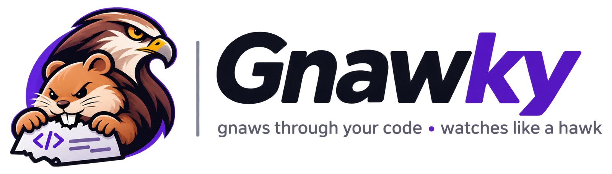

<p align="center">
  <picture>
    <source media="(prefers-color-scheme: dark)" srcset="assets/logo-dark.png">
    
  </picture>
</p>

# Gnawky

Gnawky is a local security scanner for Node.js projects. It combines proven open-source scanners, writes one report, and lets you choose per finding: **fix**, **ignore (with a reason)**, or **skip**. It also ships as a Claude Code plugin that explains findings and proposes fixes.

It can also stop risky packages before they reach your project: a [check before `npm install <pkg>` / `yarn add`](#checking-packages-before-you-install-them), pasted commands included, a [pre-commit check](#pre-commit-dependency-check) that blocks commits adding vulnerable dependencies, and a [pre-push warning](#pre-push-production-warning) about critical/high advisories that ship to production.

**New to Gnawky?** [gnawky.dev](https://gnawky.dev) shows it in action, the [presentation](https://gnawky.dev/presentation/) walks through what it does, how to use it and why, and the [docs](https://gnawky.dev/docs/) explain every feature in detail.

## What it checks

| Scanner | Finds | Required? |
|---|---|---|
| `npm audit` / `yarn audit` | Known-vulnerable dependencies (`package-lock.json` or a Yarn 1 `yarn.lock`) | Yes (npm comes with Node; yarn projects need `yarn`) |
| Next.js bundled React | React Server Components advisories in the copy of React that Next.js bundles, which `npm audit` can't see | Built in, only in Next.js projects (needs `node_modules` and Online mode) |
| [gitleaks](https://github.com/gitleaks/gitleaks) | Secrets in files and git history | Optional, recommended |
| [semgrep](https://semgrep.dev) | Risky code (injection, XSS, unsafe `eval`, etc.) | Optional, recommended |
| Full audit (Claude + Cloudflare's security-audit skill) | Vulnerabilities in your own logic that pattern scanners miss | Optional, started from AI tools in the menu |

Missing optional scanners are reported as "skipped", never silently ignored. While a scan runs, each scanner shows a live line with a running clock, and the summary lists how long each one took. Semgrep stops after 30 minutes with a clear message instead of hanging.

**Next.js bundled React.** Next.js ships its own copy of React's server code, and it patches that copy without changing its version, so neither `npm audit` nor a version check can tell whether your Next.js has a React fix. Gnawky reports only what is certain: React Server Components advisories disclosed *after* your installed Next.js was released, which that release can't contain. It stays quiet for newer releases; once Next.js publishes its own advisory, `npm audit` reports it. Dates come from the GitHub API (60 requests an hour without a token, or set `GITHUB_TOKEN`) and are cached in `.gnawky/cache/`.

```bash
brew install gitleaks semgrep        # macOS
pipx install semgrep                 # alternative for semgrep
```

## Install

Gnawky needs Node 18 or newer and has no npm dependencies of its own.

```bash
npm install -g gnawky      # npm
yarn global add gnawky     # Yarn 1
npx gnawky                 # or try it once, without installing
```

Gnawky works the same whether you install it with npm or Yarn: it checks which one the scanned project uses.

**Windows:** run Gnawky inside [WSL](https://learn.microsoft.com/windows/wsl/install) (for example Ubuntu) for full support. Natively on Windows the dependency audit and gitleaks should work, but this hasn't been tested yet: semgrep may not be available, the tool installer offers nothing, and Claude triage is turned off.

**From source:** clone this repository and run `npm link` inside it.

## Usage

Start Gnawky **inside the project you want to scan**:

```bash
cd ~/code/my-app
gnawky
```

The first time you start Gnawky in a project, a short setup runs:

1. **Your project:** detects the stack (TypeScript, Express, React, Next.js, Docker, GitHub Actions, databases, auth libraries), checks for a lockfile and git, and warns if a `.env` file is not ignored by git. It only reads `package.json` and file names.
2. **Network access:** choose **Online** (recommended: the dependency audit sends your dependency list to the npm registry, semgrep downloads its rulesets, and the AI tools are available) or **Offline** (nothing leaves this computer, but only gitleaks runs unless you add a local semgrep rules file, and the AI tools are off). Saved per project; change it any time in Settings. Starting with `gnawky --offline` pre-selects Offline.
3. **Recommended tools:** shows which scanners fit the project and which are missing, and installs them with Homebrew (or pipx for semgrep) if you choose to. It also recommends the [package check](#checking-packages-before-you-install-them), the [pre-commit check](#pre-commit-dependency-check) and the [pre-push warning](#pre-push-production-warning) when they aren't on yet.
4. **First scan:** saves semgrep rules that match the stack (for example `p/expressjs`, `p/react`, `p/dockerfile`) and offers to run the first scan.

You can run the setup again from Settings. After that you get an interactive menu (arrow keys + Enter, or number keys; `q`/Esc goes back):

```
gnawky  my-app  /Users/you/code/my-app
Last scan 27/09/2026 10:14: 1 high, 2 medium
──────────────────────────────────────────
What would you like to do?
❯ 1. Scan again
  2. Findings (3)
  3. AI tools
  4. View report
  5. Settings
  6. Tools & scanners

  Quit
```

**Findings** and **AI tools** open a submenu. After an action you come back to the same submenu; `q`/Esc or "← Back" returns to the main menu.

1. **Scan again** (**Run security scan** before the first scan): runs every enabled scanner with a live progress line each, then writes the reports.
2. **Findings** (submenu):
   - **Review & fix**: go through findings one by one and choose fix, skip, or ignore. Nothing happens until you confirm the final plan. If Claude hasn't triaged any finding yet, or a rescan found new ones that your last triage's filter would have covered (say a new critical advisory), Gnawky first offers a triage (once per session; Settings turns it off). Findings your filter left out on purpose don't trigger it. After it, Review & fix starts in Claude's order, or the usual one if you prefer.
     - **Grouped advisories**: dependency advisories that one change fixes are one item, so an old Next.js with 36 advisories is one decision instead of 36. They are grouped by the package the fix upgrades: a `postcss` advisory fixed by upgrading `next` sits in the `next` item ("Also covers: postcss (4)"). If only some advisories in an item can be fixed automatically, the item says so and the rest keep their manual fix. npm audit suggests one version per package even when it fixes only some of its advisories (for next 14.0.0 it suggests 14.2.35, which leaves 23 of 36 open), so Gnawky checks each advisory's vulnerable range against that version: the ones it doesn't fix are listed apart, with the version they need ("Fixing all of them needs a release of next after 15.5.27"). For packages installed by the upgraded one (postcss in next), npm's expectation can't be checked before the fix; the audit after the fix shows what was really fixed. Ignoring an item ignores each of its advisories, so a new advisory for that package still shows up. Browse findings and both reports group the same way; `findings.json` stays one entry per advisory. Claude's triage still judges each vulnerable package on its own, so an item that covers several packages shows Claude's take for each (for example `next`: fix now, `postcss`: likely false positive) and is ranked by the most urgent one.
     - **Verified fixes**: before applying dependency fixes, you can have Gnawky run your `test`, `build`, `lint` and `typecheck` scripts before and after the change (one package at a time, the default, or all at once). It also checks `npm ls` (or `yarn check --verify-tree`) for broken dependency trees, warns about packages that don't support your Node version, and compares the audit before and after. Then you keep the branch, undo everything, or have Claude fix a failure.
       - **When npm refuses an upgrade** (a peer dependency conflict, an override…), the results screen shows why, keeps the full output in `.gnawky/fix-failed-<package>.log`, and offers **Fix the failed upgrade with Claude**. Claude explains the conflict, proposes ways to do the upgrade (for example upgrading related packages together) and makes the change you pick, asking before every change and install (install scripts stay disabled). Back in Gnawky, it checks that the new version is installed, runs your scripts and the audit again, and updates the results. An `npm audit fix` that changes nothing is shown as such.
       - **Uncommitted changes**: a dependency fix starts from a clean state on a new branch. If you have uncommitted changes, Gnawky offers to stash them (`git stash`, untracked files included) and continue. Undo gives them back right away. After Keep, the main menu offers **Restore your changes stashed before the fix** once you're back on the branch you started from (or run `git stash pop`). `gnawky fix` without the menus still asks you to commit or stash first.
       - **When an upgrade breaks your scripts** (one package at a time), Gnawky stops and asks instead of undoing it: **fix it with Claude** (Claude adapts your code, tests or config to the new version, you approve each change, then the scripts run again and the upgrade stays if they pass), **run them again** after your own change, **undo this change** and go on with the next one, or **keep it anyway**. With all at once, the results screen offers **Fix it with Claude** the same way, and runs the failing scripts again afterwards. Code changed this way goes in the same commit (the Keep screen lists it). Undo only reverts the dependency changes and tells you which other files stay. `gnawky fix --one-at-a-time` (no menus) still undoes a breaking change automatically.
     - **Fixed advisories log**: when you keep the branch, Gnawky saves the advisories the fix removed, with their GHSA and CVE IDs, to `.gnawky/fixes/<date>.json` and a `.md` table ready to paste into a PR or ticket. The list comes from the audit run after the fix; without one (offline, or the dependency scanner off) it lists what the applied changes target and says so. `npm audit` doesn't report CVE IDs, so for npm projects they're looked up from the GitHub advisory API (up to 40 per fix; set `GITHUB_TOKEN` for a higher rate limit).
   - **Review & fix in Claude's order**: the same review in triage order: fix now, then fix soon and low priority, then findings Claude hasn't triaged, then likely false positives. Shown once a triage exists, and then listed first (the usual production-first order stays as the second option). In the plain Review & fix too, items Claude marked as likely false positives move to the end (an item stays in place if any of its advisories is real), labelled "likely false positive".
   - **Browse findings**: open any finding for details and act on just that one. A grouped item lets you fix, ignore or ask Claude about all its advisories at once, or open a single one.
   - **Ignored findings**: see every ignore decision with its reason, and restore any of them.
3. **AI tools** (submenu, needs Claude Code; turned off in offline mode). The submenu says why an item is greyed out (offline mode, Claude Code not installed, no scan yet).
   - **Triage findings**: you tick which severities (critical, high, …) and sources (dependencies, code, secrets) to triage, and see how many Claude runs that takes before you start; up to 3 runs can go at the same time (faster, same tokens, heavier on rate limits). The choice is remembered per project. Claude reads your code (read-only: it can't edit files or run commands) and labels each finding as a real issue, likely false positive, or needs a human, with an urgency (fix now, fix soon, low priority) and a short reason. Advisories are grouped per package and secrets per file, so each package or file is checked once (one verdict per file: if its secrets differ, the most serious one counts and the reason names the real lines). Results are saved in `.gnawky/triage.json`, kept across re-scans, shown in Browse and Review & fix, and added to both reports, which then list the findings in Claude's order (the HTML report's Sort menu switches back to production first). You can then review in Claude's order. They are suggestions: nothing is fixed or ignored automatically. `.env` files, keys and `.npmrc` are blocked; for files gitleaks flagged, Claude reads a temporary copy with the flagged lines hidden, and Gnawky re-scans each copy with gitleaks first and keeps the file blocked if anything is still found. Needs Claude Code; disabled in offline mode; not on Windows yet.
   - **Run a full security audit**: starts Claude Code with the bundled [security-audit skill](https://github.com/cloudflare/security-audit-skill) by Cloudflare, which audits the whole codebase for what scanners miss (broken access control, injection, data leaking between users, unsafe auth flows) and has a separate verifier check every candidate. You pick the size first: **Quick** (whole project, one pass), **Full** (whole project, the standard workflow, often 30+ minutes and a lot of tokens on a real project) or **Custom** (tick folders in a tree, open folders to pick subfolders, then choose the `quick` / `standard` / `deep` profile and an optional cap on sub-agents). A custom run is a scoped audit: the report marks everything else out of scope. The last custom choice is remembered per project. Reports go outside the project, to `~/security-audit-skill/<project>-<id>/run-N/` (`REPORT.md`, `findings.json`, `NEEDS-VALIDATION.md`). When you exit Claude, Gnawky imports the confirmed findings as a fourth source, `claude-audit`, also on every later scan, with severity, trace, conditions and the fix strategy; reproduction payloads stay in the skill's own report. Credentials files and files flagged for secrets are blocked for the session.
   - **Ask Claude for help**: starts Claude Code with the scan results, after a privacy notice (needs Claude Code; disabled in offline mode).
4. **View report**: shows the Markdown report and opens the HTML report in your browser.
5. **Settings**: minimum severity, offline mode, scanners on/off, semgrep rules, and whether semgrep skips test and mock files (`__mocks__`, `__tests__`, `fixtures`, `test(s)/`, `*.spec.*`, `*.test.*`; on by default, much faster on big projects; gitleaks still scans them for secrets). Saved per project in `.gnawky/config.json`.
6. **Tools & scanners**: shows which scanners are missing and installs them (Homebrew/pipx) if you want.

Commands that work on the last scan in `.gnawky/` (the plugin's skill uses them; run them inside the project):

```bash
gnawky scan [--json]                       # scan, then list the findings grouped like the app
gnawky findings [--json]                   # the last scan's grouped findings, with Claude's verdicts
gnawky report [--open]                     # rewrite both reports, optionally open the HTML one
gnawky triage [--severity critical,high] [--sources dependencies,code,secrets] [--all] [--parallel 3]
                                           # shows what Claude triage would send; add --yes to run it
gnawky ignore <id|GHSA|CVE|package>... --reason "why"   # a package ignores its whole grouped item
gnawky fix <package|id|GHSA|CVE>... | --all [--scripts test,build|all] [--one-at-a-time] [--pin caret|exact]
                                           # shows the fix plan; add --yes to apply it on a new branch
gnawky fix --keep | --undo                 # keep the fix branch (and log the fixed advisories) or throw it away
```

`gnawky fix` is the app's Review & fix without the menus: the same order, branch, disabled install scripts, script verification (only with `--scripts`, since it runs your project's code), audit afterwards and fixed-advisories log. After `--yes` the branch waits for `--keep` or `--undo`, like the app's results screen.

Headless mode for CI and scripts:

```bash
gnawky --no-ui                      # scan and write the reports
gnawky --ci --min-severity high     # exit 1 if findings remain, 2 if no scanner could run
gnawky --json                       # machine-readable output (used by the Claude plugin)
gnawky --offline                    # nothing leaves this computer
```

Every scan writes three files to `.gnawky/`: `findings.json`, `security-report.md`, and `security-report.html`. The HTML report is a single self-contained file (no external scripts, styles or fonts, so it works offline). It has severity tiles, a scanner summary, and every finding with full details, plus filters by severity and tool and a text search. It supports dark mode and prints cleanly. In CI, keep it as a build artifact.

Requires Node 18+ and a `package-lock.json` or a Yarn 1 (Classic) `yarn.lock`. With more than one lockfile (say a stale, git-ignored `package-lock.json` in a yarn project), Gnawky goes by package.json's `packageManager` field, then the lockfile committed to git, then the one git doesn't ignore, then the most recently changed. It says which one it chose and why in the fix plan and the workspace notes.

### Browser smoke test after a fix

After a dependency fix, the results screen also offers **Smoke test in the browser with Claude** (optional, needs Claude Code and Chrome with the Claude in Chrome extension; off in offline mode). The first time, you set it up for the project:

1. **The app's local URL.** Gnawky guesses one from the dev script.
2. **Who starts the app.** Either Gnawky runs a script it finds (`dev`, `start`, …), waits for the URL and stops the app after the test, or you start it yourself and Gnawky waits until the URL answers.
3. **The pages to check,** as paths such as `/, /cart`.

Claude Code then opens with `--chrome` and visits each page. It checks that the page renders, reads console errors and failed requests, and looks harder at features that use the upgraded packages. You watch it, and can step in when a page needs a login. Claude only writes its report, in `.gnawky/smoke/`, without asking. When you exit Claude, the results screen shows **PASS**, **FAIL** or **PARTIAL**, and you still choose Keep or Undo. What Claude sees in the browser is sent to Anthropic, so test a local or test environment, not production.

**Later.** If you keep the fix without a smoke test (or exit and come back another day), Gnawky remembers the fix branch. While you're on that branch, the main menu offers **Smoke test the fix on `<branch>` in the browser**, and the header shows whether it's been smoke-tested yet and the last result. Switching to another branch hides the option, and undoing the fix forgets it. On a `fix/upgrade-…` branch Gnawky didn't save (made by hand, or with an older Gnawky), the option shows too, with the changes read from `package.json` against `main` (or `master`/`develop`).

### When the tests already fail before a fix

When you verify a fix with your scripts (test, build, …), Gnawky runs them once before changing anything. If they already fail, it says so and lets you choose:

- **Fix them first with Claude.** Claude Code opens with the failing output and only fixes the scripts or tests, without touching dependencies. You approve each change. Afterwards Gnawky lists the changed files and offers to commit them on the branch you started from, then runs the scripts again.
- **Run them again** (e.g. after you fixed something yourself).
- **Go on with the fix anyway.** The results then compare against the failures that were already there.
- **Cancel.**

The before-run is reused for the fix, so the scripts don't run twice.

### What to fix first: production

Every dependency finding says whether it **ships to production**. Gnawky works this out from `package.json`, without Claude. A package that one of your `dependencies` brings in counts as production. One that only `devDependencies` bring in counts as dev-only. Test and lint tools (jest, vitest, eslint, @types/…) count as dev-only even when they're listed under `dependencies`, and the finding tells you to move them. In Next.js projects, devDependencies that aren't test or lint tools count as production, because the app can bundle them. Code and secret findings are always production. A finding whose dependency path can't be found counts as production, to be safe.

Critical and high findings that ship to production come first everywhere: the header ("53 to fix for production first"), Browse and Review & fix, both reports (with a **Fix for production first** tile and an **All / Production only / Dev only** filter in the HTML, in the project and the workspace report), the workspace view, and `gnawky findings` (`--prod-only` hides dev-only findings). Claude triage then checks whether the vulnerable code is actually used. Its filter starts with production critical/high only (`gnawky triage --scope production`), so it reads far fewer findings.

### Several projects at once (workspaces)

Start Gnawky in a folder that holds several projects (and has no `package.json` of its own), for example `~/code/acme` with an API, a shared library and two apps:

```bash
cd ~/code/acme
gnawky
```

1. **Pick the projects** that belong together. The list shows which ones use each other.
2. **See how they're linked.** Gnawky reads each `package.json` and lockfile. It shows who uses whom, at which installed version, and when projects use different releases of a shared one (a fix there only reaches the projects that move to it). It also gives a fix order: shared projects first, then the ones that use them.
3. **Check every project's dependencies** (npm/yarn audit, plus the React bundled in Next.js) in one go. The results show advisories found in more than one project, and the advisories each shared project brings into the projects that use it.

**Claude triage** works across the workspace too: right after a scan (before the report), or from the menu. Pick what to check (by default critical and high that ship to production); findings that already have a verdict are skipped. Claude triages one project at a time, reading that project's code, and the verdicts are saved in each project's `.gnawky/triage.json`, so opening the project later uses them. The workspace reports then show Claude's verdict and reason per finding, with likely false positives last.

Results go to `.gnawky/` in the workspace folder (`workspace.json`, `workspace-findings.json`, `workspace-report.md` and `.html`, with a map of the links). The scan writes nothing into the projects (only Claude triage saves its verdicts there). For fixes, ignoring, Claude triage, secrets and code checks, choose **Open a project**: it opens the normal Gnawky inside that project (which keeps its own `.gnawky/` there), and leaving it brings you back to the workspace. It opens straight in the project's Findings menu, with Review & fix first; going back shows the project's main menu, and back again returns to the workspace. The project starts with the workspace's results for it (marked "workspace, dependencies only"), so it isn't scanned twice, and its first-time setup uses the workspace's online/offline choice. **Full scan** there adds secrets and code checks.

```bash
gnawky workspace                          # list the projects and how they use each other
gnawky workspace --projects api,web,utils # pick projects (saved for next time)
gnawky workspace scan                     # check them all and write the workspace report
gnawky workspace report                   # show the last workspace scan
```

### Yarn projects

Gnawky uses `yarn audit` and works out a fix for each vulnerable package, without extra registry calls:

- **Direct dependency**: the version in `package.json` is raised to the first patched version (exact pins stay exact, `^`/`~` ranges keep their operator), then `yarn install`.
- **Installed by other packages, patch fits their ranges**: the vulnerable `yarn.lock` entries are re-resolved (the yarn equivalent of `npm audit fix`).
- **Installed by other packages, pinned to an old version**: a `"resolutions"` override in `package.json`, labeled as risky, and as breaking when it crosses a major version. Gnawky never forces healthy copies of a package onto another major version; in that case it suggests a path-specific resolution instead.

Upgrades run before overrides, and an override is skipped when an earlier upgrade already removed the vulnerable versions. Yarn 2+ (Berry) and pnpm lockfiles are not supported yet.

### Forcing a version of a sub-dependency

When a vulnerable package is only installed by other packages and they pin an old version, `npm audit fix` can't help. Gnawky then forces the lowest patched version: with `"resolutions"` in Yarn projects and `"overrides"` in npm projects (it looks up the published versions with `npm view`, from the registry your project uses). Like resolutions, an override is labeled risky, or breaking when it crosses a major version, and is never used when it would move healthy copies to another major version (Gnawky suggests a nested override instead).

Before the plan runs, Gnawky asks how to write each forced version, and marks one choice as recommended:

- **`^2.5.6` (range)**: later 2.x releases still arrive, including future security fixes. Recommended by default.
- **`2.5.6` (exact)**: stays on that version until you change it. Pick this if a newer release is broken. Recommended when `package.json` already pins that package exactly, or when the project pins its dependencies exactly (`save-exact` in `.npmrc` / `.yarnrc`, or every dependency in `package.json` is an exact version).

To force a version Gnawky didn't suggest (for example an older one, because the latest has a bug), edit the entry yourself: Gnawky keeps it, and recommends keeping it exact the next time it has to change it.

### Checking packages before you install them

Turn on **Settings → Check packages before npm install / yarn add** and Gnawky checks every package you add, including commands pasted from the web. It adds a few shell functions to `~/.zshrc` (for bash: `~/.bash_profile` on macOS, `~/.bashrc` elsewhere), in a marked block that Settings removes again. It applies to every project on the computer, and Gnawky updates the block when a newer version changes it.

When you run `npm install <pkg>` (or `npm i`, `npm add`, `yarn add`, `yarn workspace <name> add`), Gnawky first resolves the new packages in a temporary folder with `npm install --package-lock-only --ignore-scripts`: nothing is downloaded into your project and no install scripts run. Only packages that aren't already in your lockfile are checked:

```
$ yarn add lodash@4.17.20 minimist@0.0.8
  ✖ 2 new packages checked, 3 problem(s) (3s)
  ✖ CRITICAL minimist@0.0.8: Prototype Pollution in minimist https://github.com/advisories/GHSA-xvch-5gv4-984h
  ✖ HIGH lodash@4.17.20: Command Injection in lodash https://github.com/advisories/GHSA-35jh-r3h4-6jhm
  • MEDIUM lodash@4.17.20: Regular Expression Denial of Service (ReDoS) in lodash …
  Recommended:
    lodash@4.18.0   fixes these advisories
    minimist@0.2.4  fixes these advisories, major update from 0.0.8, check its changelog
  → yarn add lodash@4.18.0 minimist@0.2.4
gnawky: install anyway? [y/N]
```

- **Recommends a safe version** for each flagged package, with the same command rewritten to use it: the lowest version outside every advisory's range (and whether it's the latest), and only after a real `npm audit` of that version's dependency tree finds no high or critical advisories. When there's no fixed version, it says so.
- **Asks before installing** for high and critical advisories (including malware advisories), and for versions published in the last 2 days, before most malicious releases are caught. Install scripts and lower-severity advisories are shown without a question.
- **Everything else runs unchanged**: `npm install`, `npm run …`, `yarn build`. Global installs aren't checked, and neither are git URLs, local paths or tarballs. Skip the check once with `GNAWKY_SKIP=1 npm install <pkg>`.
- **Never blocks an install by breaking**: if the check can't run (no network, a resolution error, offline mode in that project), the command runs as usual with a note.
- **Privacy**: advisories come from your configured registry (like `npm audit`). Publish dates come from [deps.dev](https://deps.dev), and only for packages resolved from the public npm registry, so private package names never leave your registry.
- **Works with Node version managers**: nvm (also with lazy loading, where `npm` is a function that loads nvm first), fnm, Volta, asdf and corepack. When Gnawky isn't installed for the Node version in use (after `nvm use`), you get a one-time note and the command runs unchecked. If Gnawky itself can't start, the command runs as usual; Ctrl+C during the check stops it.
- **Limits**: it only covers your own terminal (zsh and bash), not CI, IDE buttons or teammates. A malicious package published hours ago has no advisory yet; the 2-day check is the only signal for those.

### Pre-commit dependency check

The package check only covers your own terminal. The pre-commit check is the next layer: turn it on in **Settings → Pre-commit dependency check** (setup recommends it too). When a commit changes `package-lock.json` or `yarn.lock`, Gnawky audits the dependencies in the commit, compares them with the last commit, and blocks the commit only if it **adds** high or critical findings:

```
  gnawky: package-lock.json changed, checking new dependencies…
  ✖ package-lock.json: 2 new finding(s), 2 lower-severity (1s)
  HIGH     lodash: Command Injection in lodash  https://github.com/advisories/GHSA-35jh-r3h4-6jhm

Commit blocked: this commit adds 2 high/critical finding(s).
Fix them (gnawky → Findings), ignore them with a reason in gnawky, or commit anyway with git commit --no-verify.
```

- **Old findings never block**, so a project with known issues can still commit. Ignored findings (with a reason) don't block either.
- **Where it goes**: with husky, in `.husky/pre-commit`, so the team gets it when you commit that file. With another `core.hooksPath`, in that folder. Otherwise in `.git/hooks/pre-commit`, for this clone only. For lefthook, Gnawky shows a snippet for `lefthook.yml`, because lefthook rewrites its hook scripts. An existing hook keeps working: Gnawky adds a marked block at the top and removes only that block again.
- **Never blocks for its own problems**: in offline mode, without a network, if the audit fails, or for teammates who don't have gnawky installed, the commit goes through (with a note).
- Run it by hand with `gnawky pre-commit` (`--min-severity critical` to block only critical findings).

### Pre-push production warning

The pre-commit check only looks at what a commit adds. The pre-push warning is a reminder of what is already there: turn it on in **Settings → Pre-push production warning** (setup recommends it too). Before every `git push`, Gnawky lists the packages with critical or high advisories that ship to production, old ones included, grouped by the package to upgrade:

```
  ! my-app: 2 package(s) with critical/high advisories ship to production (2s)
    HIGH     axios    11 advisories: upgrade axios to 1.12.0  (direct dependency)
    HIGH     express  6 advisories: upgrade express to 4.22.3  (direct dependency)

gnawky: pushing anyway; this is a reminder, not a block.
```

- **It never blocks.** The push always goes through, also when the audit fails or the project is in offline mode.
- **Production only**, worked out the same way as the production priority in Findings: a package counts when a `dependencies` entry brings it in. Dev-only packages (test runners, linters, build tools) are left out, and in Next.js projects devDependencies that aren't tooling count as production. Ignored findings are left out too.
- **A fresh audit on every push**, so advisories published since your last scan show up too. It usually takes a few seconds. If the audit fails (no network, registry down), Gnawky shows the last results for the same dependencies instead, with their date and a note that newer advisories are missing.
- **Every project in the repository**: each folder with a lockfile tracked by git is checked, so it works in monorepos too.
- **Where it goes**: the same as the pre-commit check (`.husky/pre-push`, your `core.hooksPath`, or `.git/hooks/pre-push`; a snippet for lefthook). It reads nothing from the hook's input, so other pre-push tools like git-lfs keep working.
- Run it by hand with `gnawky pre-push` (`--json` for scripts), or ask Claude with `/gnawky:prod`.

## Safety model

- **The scan is read-only.** Nothing changes unless you choose a fix in the app and confirm the plan.
- **Fixes happen on a new git branch**, and only if your working tree is clean, so you can review with `git diff` and throw everything away in one command.
- **No install scripts run during fixes** (`--ignore-scripts` for npm and yarn), and `npm audit fix --force` is never used. Semver-major upgrades are labeled as breaking and need their own approval. `npm rebuild` is only offered when a check fails, with its own warning.
- **Your project's code only runs if you say so.** Verifying a fix runs your package.json scripts, which is opt-in every time and shows the exact commands. It never happens in headless or `--ci` mode.
- **Secrets are never written to reports.** gitleaks runs with `--redact`, and code snippets are excluded.
- **No shell.** External tools are launched with argument arrays, so file names or package data can't inject commands. Package specs are validated before `npm install`.
- **Offline mode** (chosen during setup, in Settings, or `--offline`): npm/yarn audit is skipped (it sends your dependency list to the registry), semgrep only uses local rule files, and "Ask Claude" is disabled. Outside offline mode your source code is still never uploaded: only the dependency list goes to the registry, and semgrep downloads its rulesets with metrics turned off.
- **"Ask Claude" shows a privacy notice first**: anything Claude reads is sent to Anthropic. Claude is told not to open `.env` files, keys, or files flagged as containing secrets; for a hard block, add deny rules in Claude Code's permission settings.
- **Reports stay out of git**: `.gnawky/` ignores itself. `.gnawky-ignore.json` *is* meant to be committed so your team shares ignore decisions and their reasons.

## Claude Code plugin

The repo is also a plugin (`.claude-plugin/plugin.json`) named `gnawky`, so you can talk to Gnawky in a Claude Code session:

```
gnawky find any security issues
gnawky generate the report
gnawky triage the findings, high and critical only
gnawky what's wrong with next?
gnawky anything critical in production?
gnawky ignore the lodash advisories, we only use it in build scripts
gnawky fix next
```

- `gnawky` skill: picks up requests that mention Gnawky and runs the matching command below, then explains the results in grouped items, with Claude's verdicts where there are any. Before a triage it shows what will be sent and asks you; ignores need your reason. For fixes it shows Gnawky's plan, suggests an order (or splitting a risky major upgrade into its own branch), asks whether to verify with your scripts, and applies it with `gnawky fix` only after you agree; you then choose keep or undo. Claude doesn't install packages or edit the lockfile itself. Claude picks skills by their description, so a request without "gnawky" in it may not use it; the slash commands always do.
- `/gnawky:scan`, `/gnawky:report`, `/gnawky:triage`, `/gnawky:fix`: the same as slash commands
- `/gnawky:prod`: the quick production check (`gnawky pre-push --json`, the same check as the [pre-push warning](#pre-push-production-warning)): a fresh audit listing the critical/high advisories that ship to production, in a few seconds, without a full scan
- `security-reviewer` agent: read-only triage of true vs. false positives, drafts minimal fix diffs
- `security-audit` skill (`gnawky:security-audit`): Cloudflare's multi-phase audit skill, bundled unmodified under its MIT license. See `skills/security-audit/VENDORED.md` for the source commit and how to update it. Gnawky loads it with `--plugin-dir`, so the menu item works without installing the plugin.

Add it in Claude Code, straight from GitHub. The plugin brings its own copy of Gnawky; install the npm package too for the terminal app and the git hooks:

```
/plugin marketplace add andreiciungan/gnawky
/plugin install gnawky@gnawky-marketplace
```

From a local clone, use its path instead: `/plugin marketplace add /path/to/gnawky`.

Check the current Claude Code plugin docs if the commands differ in your version: https://docs.claude.com/en/docs/claude-code/overview

## Roadmap ideas

- Built-in Node-specific checks (e.g. `helmet` missing in Express, `cookie` without `httpOnly`/`secure`)
- Apply semgrep autofixes with per-edit approval
- SARIF output for GitHub code scanning
- A GitHub Actions workflow that checks pull requests that change dependencies, plus a weekly run for new advisories (needs Gnawky published on npm)
- Offer `ignore-scripts=true` in `.npmrc` / `.yarnrc`, listing the packages that would then need `npm rebuild`
- Support for pnpm and Yarn 2+ lockfiles

## License

[MIT](LICENSE) © 2026 Andrei Ciungan. The bundled security-audit skill in `skills/security-audit/` is by Cloudflare and keeps its own [MIT license](skills/security-audit/LICENSE).
