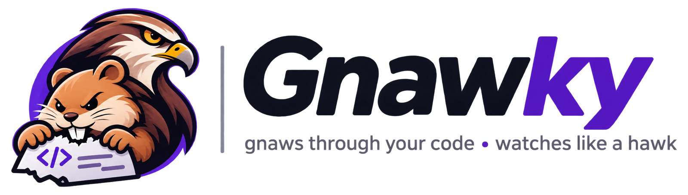

<p align="center">
  <picture>
    <source media="(prefers-color-scheme: dark)" srcset="assets/logo-dark.png">
    
  </picture>
</p>

# Gnawky

Gnawky is a local security scanner for Node.js projects. It combines proven open-source scanners, writes one report, and lets you choose per finding: **fix**, **ignore (with a reason)**, or **skip**. It also ships as a Claude Code plugin that explains findings and proposes fixes.

## What it checks

| Scanner | Finds | Required? |
|---|---|---|
| `npm audit` / `yarn audit` | Known-vulnerable dependencies (`package-lock.json` or a Yarn 1 `yarn.lock`) | Yes (npm comes with Node; yarn projects need `yarn`) |
| [gitleaks](https://github.com/gitleaks/gitleaks) | Secrets in files and git history | Optional, recommended |
| [semgrep](https://semgrep.dev) | Risky code (injection, XSS, unsafe `eval`, etc.) | Optional, recommended |
| Full audit (Claude + Cloudflare's security-audit skill) | Vulnerabilities in your own logic that pattern scanners miss | Optional, started from AI tools in the menu |

Missing optional scanners are reported as "skipped", never silently ignored. While a scan runs, each scanner shows a live line with a running clock, and the summary lists how long each one took. Semgrep stops after 30 minutes with a clear message instead of hanging.

```bash
brew install gitleaks semgrep        # macOS
pipx install semgrep                 # alternative for semgrep
```

## Usage

Install once (inside this folder):

```bash
npm link
```

Then start it **inside the project you want to scan**:

```bash
cd ~/code/my-app
gnawky
```

The first time you start Gnawky in a project, a short setup runs:

1. **Your project:** detects the stack (TypeScript, Express, React, Next.js, Docker, GitHub Actions, databases, auth libraries), checks for a lockfile and git, and warns if a `.env` file is not ignored by git. It only reads `package.json` and file names.
2. **Recommended tools:** shows which scanners fit the project and which are missing, and installs them with Homebrew (or pipx for semgrep) if you choose to.
3. **First scan:** saves semgrep rules that match the stack (for example `p/expressjs`, `p/react`, `p/dockerfile`) and offers to run the first scan.

You can run the setup again from Settings. After that you get an interactive menu (arrow keys + Enter, or number keys; `q`/Esc goes back):

```
gnawky  my-app  /Users/you/code/my-app
Last scan 27/09/2026 10:14: 1 high, 2 medium
──────────────────────────────────────────
What would you like to do?
❯ 1. Scan again
  2. Findings (3)
  3. AI tools
  4. View report
  5. Settings
  6. Tools & scanners

  Quit
```

**Findings** and **AI tools** open a submenu; after an action you come back to the same submenu, and `q`/Esc or "← Back" returns to the main menu.

- **Findings**: Review & fix, Review & fix in Claude's order (once a triage exists), Browse findings, Ignored findings.
- **AI tools** (Claude Code): Triage findings, Run a full security audit, Ask Claude for help. The submenu says why an item is greyed out (offline mode, Claude Code not installed, no scan yet).

- **Review & fix**: go through findings one by one and choose fix, skip, or ignore. Nothing happens until you confirm the final plan.
- **Verified fixes**: before applying dependency fixes, you can have Gnawky run your `test`, `build`, `lint` and `typecheck` scripts before and after the change (all at once, or one package at a time with automatic undo of any upgrade that breaks them). It also checks `npm ls` (or `yarn check --verify-tree`) for broken dependency trees, warns about packages that don't support your Node version, and compares the audit before and after. Then you keep the branch, undo everything, or ask Claude to investigate a failure.
- **Browse findings**: open any finding for details and act on just that one.
- **Triage findings** (AI tools): you tick which severities (critical, high, …) and sources (dependencies, code, secrets) to triage, and see how many Claude runs that takes before you start; up to 3 runs can go at the same time (faster, same tokens, heavier on rate limits). The choice is remembered per project. Claude reads your code (read-only: it can't edit files or run commands) and labels each finding as a real issue, likely false positive, or needs a human, with an urgency (fix now, fix soon, low priority) and a short reason. Advisories are grouped per package and secrets per file, so each package or file is checked once (one verdict per file: if its secrets differ, the most serious one counts and the reason names the real lines). Results are saved in `.gnawky/triage.json`, kept across re-scans, shown in Browse and Review & fix, and added to both reports. You can then review in Claude's order. They are suggestions: nothing is fixed or ignored automatically. `.env` files, keys and `.npmrc` are blocked; for files gitleaks flagged, Claude reads a temporary copy with the flagged lines hidden, and Gnawky re-scans each copy with gitleaks first and keeps the file blocked if anything is still found. Needs Claude Code; disabled in offline mode; not on Windows yet.
- **Run a full security audit** (AI tools): starts Claude Code with the bundled [security-audit skill](https://github.com/cloudflare/security-audit-skill) by Cloudflare, which audits the whole codebase for what scanners miss (broken access control, injection, data leaking between users, unsafe auth flows) and has a separate verifier check every candidate. You pick the size first: **Quick** (whole project, one pass), **Full** (whole project, the standard workflow, often 30+ minutes and a lot of tokens on a real project) or **Custom** (tick folders in a tree, open folders to pick subfolders, then choose the `quick` / `standard` / `deep` profile and an optional cap on sub-agents). A custom run is a scoped audit: the report marks everything else out of scope. The last custom choice is remembered per project. Reports go outside the project, to `~/security-audit-skill/<project>-<id>/run-N/` (`REPORT.md`, `findings.json`, `NEEDS-VALIDATION.md`). When you exit Claude, Gnawky imports the confirmed findings as a fourth source, `claude-audit`, also on every later scan, with severity, trace, conditions and the fix strategy; reproduction payloads stay in the skill's own report. Credentials files and files flagged for secrets are blocked for the session.
- **Ask Claude for help**: starts Claude Code with the scan results, after a privacy notice (needs Claude Code; disabled in offline mode).
- **View report**: shows the Markdown report and opens the HTML report in your browser.
- **Ignored findings**: see every ignore decision with its reason, and restore any of them.
- **Settings**: minimum severity, offline mode, scanners on/off, semgrep rules, and whether semgrep skips test and mock files (`__mocks__`, `__tests__`, `fixtures`, `test(s)/`, `*.spec.*`, `*.test.*`; on by default, much faster on big projects; gitleaks still scans them for secrets). Saved per project in `.gnawky/config.json`.
- **Tools & scanners**: shows which scanners are missing and installs them (Homebrew/pipx) if you want.

Headless mode for CI and scripts:

```bash
gnawky --no-ui                      # scan and write the reports
gnawky --ci --min-severity high     # exit 1 if findings remain, 2 if no scanner could run
gnawky --json                       # machine-readable output (used by the Claude plugin)
gnawky --offline                    # nothing leaves this computer
```

Every scan writes three files to `.gnawky/`: `findings.json`, `security-report.md`, and `security-report.html`. The HTML report is a single self-contained file (no external scripts, styles or fonts, so it works offline). It has severity tiles, a scanner summary, and every finding with full details, plus filters by severity and tool and a text search. It supports dark mode and prints cleanly. In CI, keep it as a build artifact.

Requires Node 18+ and a `package-lock.json` or a Yarn 1 (Classic) `yarn.lock`.

### Yarn projects

Gnawky uses `yarn audit` and works out a fix for each vulnerable package, without extra registry calls:

- **Direct dependency**: the version in `package.json` is raised to the first patched version (exact pins stay exact, `^`/`~` ranges keep their operator), then `yarn install`.
- **Installed by other packages, patch fits their ranges**: the vulnerable `yarn.lock` entries are re-resolved (the yarn equivalent of `npm audit fix`).
- **Installed by other packages, pinned to an old version**: a `"resolutions"` override in `package.json`, labeled as risky, and as breaking when it crosses a major version. Gnawky never forces healthy copies of a package onto another major version; in that case it suggests a path-specific resolution instead.

Upgrades run before overrides, and an override is skipped when an earlier upgrade already removed the vulnerable versions. Yarn 2+ (Berry) and pnpm lockfiles are not supported yet.

## Safety model

- **The scan is read-only.** Nothing changes unless you choose a fix in the app and confirm the plan.
- **Fixes happen on a new git branch**, and only if your working tree is clean, so you can review with `git diff` and throw everything away in one command.
- **No install scripts run during fixes** (`--ignore-scripts` for npm and yarn), and `npm audit fix --force` is never used. Semver-major upgrades are labeled as breaking and need their own approval. `npm rebuild` is only offered when a check fails, with its own warning.
- **Your project's code only runs if you say so.** Verifying a fix runs your package.json scripts, which is opt-in every time and shows the exact commands. It never happens in headless or `--ci` mode.
- **Secrets are never written to reports.** gitleaks runs with `--redact`, and code snippets are excluded.
- **No shell.** External tools are launched with argument arrays, so file names or package data can't inject commands. Package specs are validated before `npm install`.
- **Offline mode** (Settings, or `--offline`): npm/yarn audit is skipped (it sends your dependency list to the registry), semgrep only uses local rule files, and "Ask Claude" is disabled. Outside offline mode your source code is still never uploaded: only the dependency list goes to the registry, and semgrep downloads its rulesets with metrics turned off.
- **"Ask Claude" shows a privacy notice first**: anything Claude reads is sent to Anthropic. Claude is told not to open `.env` files, keys, or files flagged as containing secrets; for a hard block, add deny rules in Claude Code's permission settings.
- **Reports stay out of git**: `.gnawky/` ignores itself. `.gnawky-ignore.json` *is* meant to be committed so your team shares ignore decisions and their reasons.

## Claude Code plugin

The repo is also a plugin (`.claude-plugin/plugin.json`) with:

- `/security-scan`: runs the scanner, explains each finding, recommends fixes, and asks before changing anything
- `security-reviewer` agent: read-only triage of true vs. false positives, drafts minimal fix diffs
- `security-audit` skill (`gnawky:security-audit`): Cloudflare's multi-phase audit skill, bundled unmodified under its MIT license. See `skills/security-audit/VENDORED.md` for the source commit and how to update it. Gnawky loads it with `--plugin-dir`, so the menu item works without installing the plugin.

Install it locally through the included `marketplace.json`:

```
/plugin marketplace add /path/to/gnawky
/plugin install gnawky@gnawky-marketplace
```

Check the current Claude Code plugin docs if the commands differ in your version: https://docs.claude.com/en/docs/claude-code/overview

## Roadmap ideas

- Built-in Node-specific checks (e.g. `helmet` missing in Express, `cookie` without `httpOnly`/`secure`)
- Apply semgrep autofixes with per-edit approval
- HTML report and SARIF output for GitHub code scanning
- Support for pnpm and Yarn 2+ lockfiles
